*How my little game „Wildwechsel“ came to be*

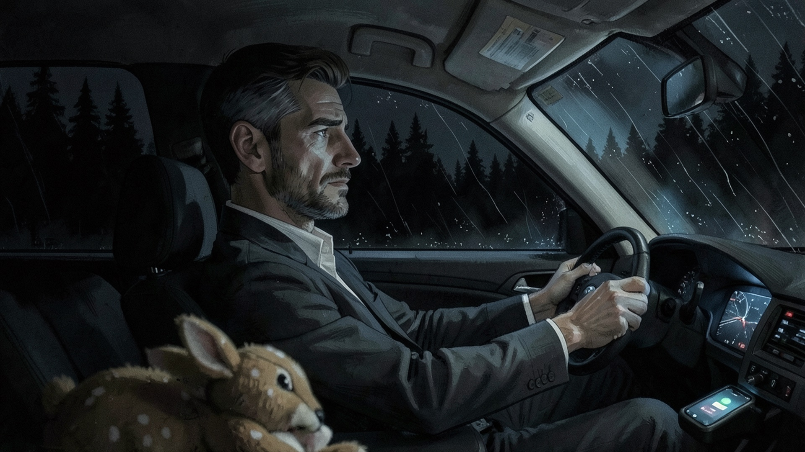

On Thursday, October 22nd, I had an idea for a game. More precisely: a picture in my head. A man drives through the
forest at night, it's raining, the phone buzzes. His daughter is calling. He declines the call. "Not now, sweetie."

One week later there was a build on GitHub for Windows, Linux and macOS, signed and notarized. Today the game is out on
[itch.io](https://pmoscode.itch.io/wildwechsel) and [Game Jolt](https://gamejolt.com/games/wildwechsel/1112928). In
between: 49 commits, a good ten thousand lines of GDScript, 87 voiced lines, fifteen
pieces of music and a lot of evenings on which I went to bed far too late.

I want to write down how it went. Not as a tutorial, more as a workshop report. And because half the questions about a
project like this nowadays boil down to "And how much of it did the AI do?", I'll be honest about that too.

<!--more-->

## What it's about

„Wildwechsel“ is a short top-down dungeon crawler, somewhere between Zelda and Hyper Light Drifter. You play Jonas
Berger, mid-forties, overworked. He missed his daughter Mia's school play, she played "the wind". On the way home he
listens to her voice message, glances at his phone, and when he looks up again, there is a deer on the road. It looks
at him.

He yanks the wheel, the car slides down the embankment and gets stuck on a pine tree. Then a beep.

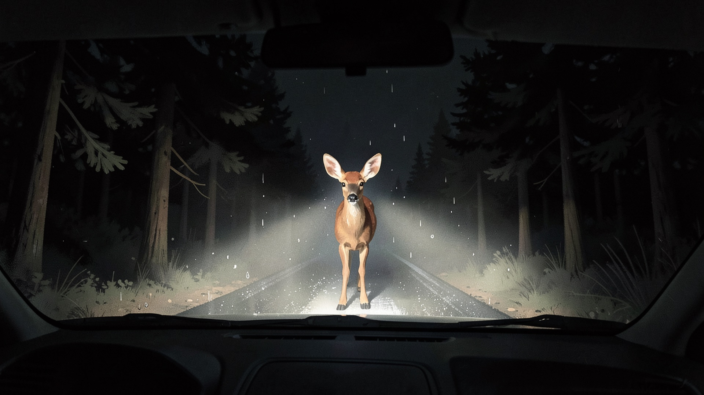

Jonas comes to in the wreck. The forest is far too quiet. Somewhere Mia's voice whispers "Drive carefully, okay?", and
at the end of a clearing stands a stone gate with three strange symbols on it. Between the trees, the deer is waiting.

Behind the gate lies a labyrinth of rooms that rearranges itself on every attempt. Three bosses, one final boss, about
45 minutes of playtime.

I don't really want to reveal more of the story than that. The rest you should find out for yourself.

## The name

I had the title before anything else was settled. "Wildwechsel" is the German word for the yellow "deer crossing"
road sign that Jonas drives past in the first scene. But it's also a pretty accurate word for what happens afterwards:
literally read, it's a "wild switch" between two worlds. I like titles that mean something completely harmless in the
first minute and something else by the end.

## Day 1: First the story, then the sound

I didn't write the story in an editor, but in a long conversation with Claude on claude.ai. Characters, plot, bosses,
ending. At the end of that conversation there was a handover that I put into the repository as `CLAUDE.md`, and from
there things continued in Claude Code. Over the week this file grew into a kind of project diary. Every decision is in
there, every wrong turn, every number we tweaked. Honestly, it's the best documentation I have ever had for a private
project, and only because I didn't have to write it myself.

The first thing that landed in the repository, though, wasn't game code but a Python script that generates sounds.
Beeps, noise, breaths. Purely synthetic, using only the standard library. That sounds like a strange
order of things, but sound was the most important part of this game to me from the start. A large part of the story
is told through the ears.

The same evening came the first commit I'm still a little proud of. The beep that runs through the whole game was
originally at 960 Hz. Sounds irrelevant. It isn't, though, when all the music in the game is in A minor, because 960 Hz
is roughly a quarter tone off the A5. Since then it beeps at 880 Hz, and when it sounds together with the music, it
fits. You don't notice something like that consciously. You only notice
when it's wrong.

## Voices: ElevenLabs, after a few detours

The game is fully voiced, in German. I have no studio and no voice actors for that, so it came down to speech
synthesis. I tried several things. Suno had just released a voice feature as a beta, which was useless for my
purposes: no fixed voice per character, plus a download limit. In the end it became ElevenLabs.

A small stumbling block at the beginning: on the free tier the API locks voices from the public library, you just get
an error 402 back. So, a trial month on the Starter plan. For each character there were a few candidate voices that
all spoke the same sample line, and I picked the one that fit. All the lines and samples together cost about 2,000
credits, which was a lot less than I had feared.

The voice lines live in a simple CSV file: who speaks, with which emotion, the subtitle text, an English stage
direction for ElevenLabs (for example `[whispers]`) and a column `raumeffekt` (room effect). A script only sends the
lines that have changed to the API and turns the result into normalized Ogg files. If I don't like an intonation, I
have three takes generated and pick the best.

The most important decision here was to generate the voices **clean**. No reverb, no distortion. The room sound is
only added by Godot at runtime, via separate audio buses per effect. That way every act can sound different without
regenerating a single line. Why they sound the way they do, you'll find out in the game.

A detail that cost me an evening: each of these effects changes the loudness. A low-pass filter takes something away,
reverb adds something. The phone in the intro ended up 17 dB too quiet and was practically inaudible in the rain. Now a
test script measures the output of every bus, and every effect has its own compensation, so that every line arrives
in the game at the same volume.

## Day 2: A branch, a labyrinth and a boss that breathes

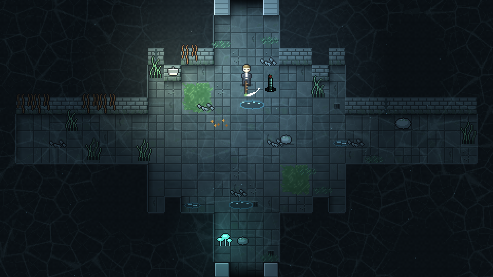

From the second day on, it became a game. Godot 4, internal resolution 480 × 270, 16-pixel tiles, integer-scaled. I
also tried 320 × 180, which looks prettier in a retro way, but you see too little of the room.

You fight with a branch. Jonas tears it off a fallen tree in the forest, and it stays his weapon the whole time. After
each boss you gain an ability, but more on that in a moment.

The rooms are handmade, as text maps in simple `.txt` files: `#` is a wall, `.` is floor, `S` a spawn spot for an
enemy, `?` a wall that may or may not be there. On every attempt a generator builds a new map from them: a main path
from the start to the boss, side branches, a hidden room. Certain rooms where the story happens always sit in the same
place, though. I didn't want a completely random world, but one that feels like it's rebuilding itself behind your
back.

And then the first boss, The Breathless. A pale figure with a tube instead of a mouth, while the arena slowly fills
with water.

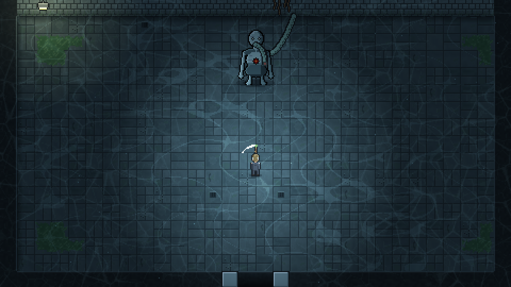

With him I married music and game mechanics directly for the first time. The Breathless breathes in time with his
boss music. Two bars are exactly five seconds, i.e. one breath. On the accent of the music he fires a water jet,
aiming just before. At the end of the bar he inhales and pulls Jonas towards him. He's only vulnerable while the valve
on his chest is visible. If you listen, you can play the fight almost blind. To stay in time across the loop point of
the music, he reads his clock directly from the playback position of the track.

## Music from Suno, and why everything is in A minor

I made the music with Suno. Ambient, lots of piano, a bit of percussion in the fights and a song with vocals for the
credits. The prompts are in a separate file in the repository, together with what I learned about Suno. For example,
that "no drums" works poorly because Suno picks up the word "drums", and that you're better off writing "beatless" or
"drumless".

All tracks are in A minor so that transitions fit together and the beep is in tune everywhere. Suno doesn't always
stick to that. The forest track "Stillness in the pines" came back in F minor. Instead of regenerating it, the forest
now simply beeps a semitone lower, and a fade to white covers the switch into the first act.

For the loops there's a script that measures tempo and downbeat by itself. That was necessary too, because Suno
doesn't always hit the tempo from the prompt: "Rising Heat" runs at 109 instead of 110 BPM, and "Clinical Rhythm" gets
slower over the course of the track. For tracks like these the script looks for cut points by sound rather than by the
bar grid.

By the way, Suno can't repeat a melody across several tracks. For Mia's leitmotif, "Mias Wind", Claude therefore wrote
a MIDI file: A minor, 3/4 time, eight bars. I played it back with a piano in GarageBand and exported it. The motif
only appears twice, and I won't reveal either place.

## The night before day 3: The intro

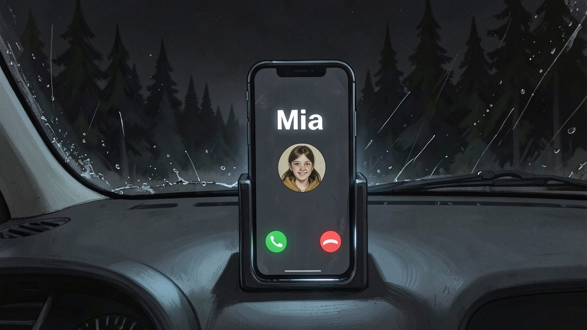

Reality, meaning the intro and the ending, is painted. The world in between is pixel art. This break in style is
intentional: you should feel, without explanation, which world you're in.

The images are created locally in ComfyUI on my Mac, with FLUX.2 [klein] 4B. I deliberately chose that model because
of its license (Apache 2.0); I wouldn't be allowed to use the larger FLUX models commercially. For edits,
Qwen-Image-Edit was added later. A script assembles the requests to ComfyUI, with reference images for every
character, so that Jonas looks like Jonas in every scene.

I could write a separate post about what I learned about image models along the way. A few samples:

- If you write what should **not** be in the picture, it's guaranteed to show up. "Without antlers" produced a deer
  with antlers.
- "Plush fawn" turned into a rabbit. "A baby deer toy with white spots" worked.
- Without "deep night under a black sky" and forest, a night scene turns into a city at dusk.
- Hands on the steering wheel, seen from the front: always a fist with three fingers. With every seed, every phrasing,
  even when specifically repainting only the hands. In the end the solution wasn't a better phrasing but a different
  camera. The first image now shows Jonas in profile from the passenger seat, with Mia's plush deer in the foreground.
  I think the image turned out better than originally planned because of it.

My favorite problem was the crash image. The car was supposed to stand at the bottom of the embankment against a pine
tree, exactly as the player sees it in the game afterwards. From the side, from the front, from above: perspective,
road and the gap in the guardrail never matched the game scene. What finally helped was a screenshot of the game scene
as a template. The image model took over the viewing angle and layout and "repainted" everything. Of course, anything
that should be right in the picture, such as the skid marks on the slope, has to be visible in the game already.

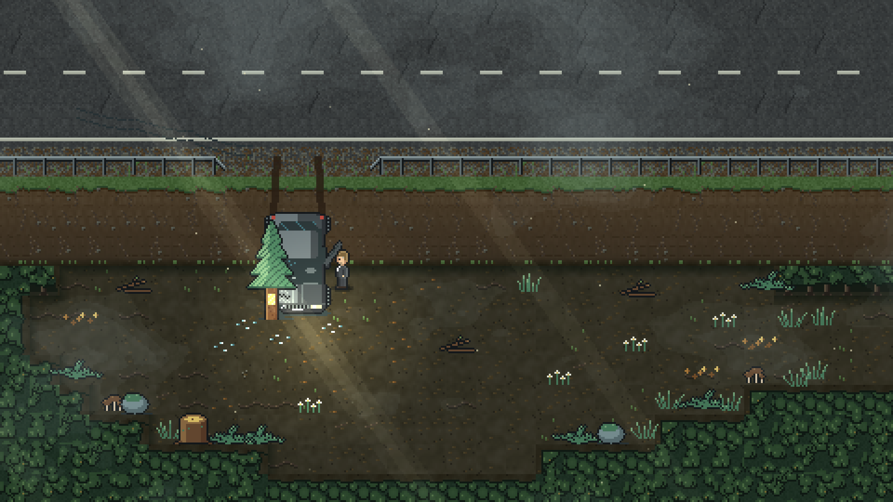

The intro itself is a sequence of images with a slow zoom, voices and car sounds. The crash is cut to the tenth of a
second: cut to the swerve when the tires screech, cut to the impact after 1.45 seconds, the image shakes once more on
the second hit, silence after 3.3 seconds. Then black. Then the beep.

Then the image opens up, and you're stuck in the wreck. The door is jammed, you have to push against it four times.
Only then does Jonas fall out, get up and look back at the car. What happens next, you'll have to play yourself.

## Day 3: Heat and cold light

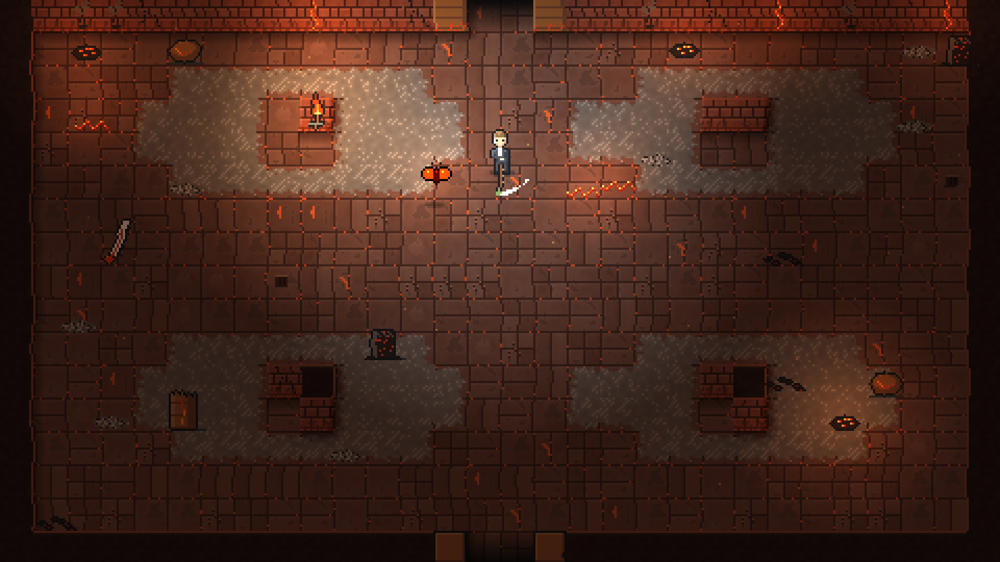

On Saturday, the second and third acts were created in a single day. That sounds like more than it was, because the
act code is the same for all acts. What makes an act is defined in a table: room templates, enemies, tiles, light,
particles, music, boss. The second act is all about heat: reddish-brown stones, glowing cracks, heat haze as a shader,
sparks instead of floating particles. The boss is The Ember, a fire creature that is only vulnerable when it has burned
itself out.

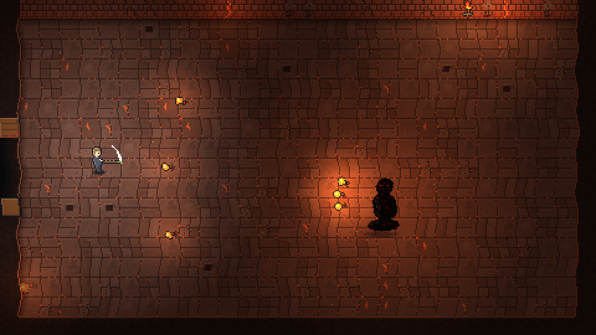

The third act is the opposite: cold, bright tiles with rust stains and neon light that occasionally flickers out. The
boss is called The Smith, a giant with a very large hammer.

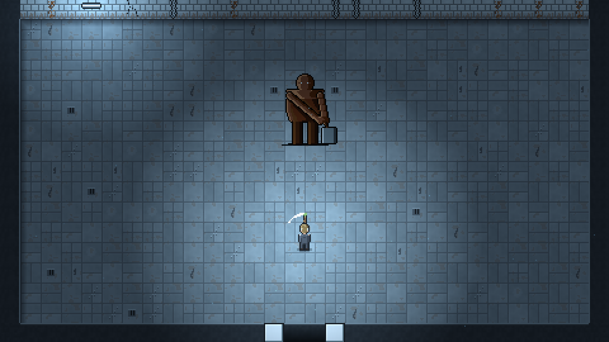

After each boss Jonas gets something: after The Breathless, the Breath (a short sprint that gets you across gaps);
after The Ember, an ember you can throw that melts thorns and ice; after The Smith, his hammer, which smashes cracked
walls. Later rooms require the abilities from before.

## What the walls tell

This is the part of the game I'm most attached to. In the world in between, things happen that don't seem to make
sense at first. Sounds, lights and voices that don't belong there.

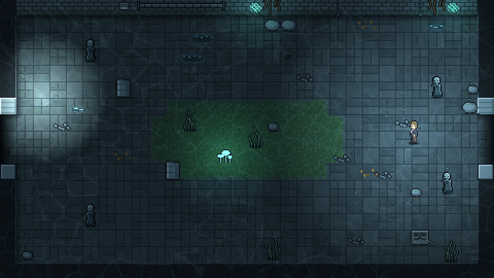

None of this is explained in the game. If you pay attention, you might start to suspect what it is. And I won't spoil
it here either. The deer keeps appearing at the edges of rooms and leads to hidden passages. What it is, I deliberately
leave open.

On top of that there are three puzzle rooms per act, which I internally call "reaction rooms". In one, a spot of light
wanders through a dark room, and you have to stay inside it long enough. In another there are stones with words on
them that you have to touch in the right order until a sentence emerges. In the third you push stone blocks onto
pressure plates. What happens when you solve them is part of the story.

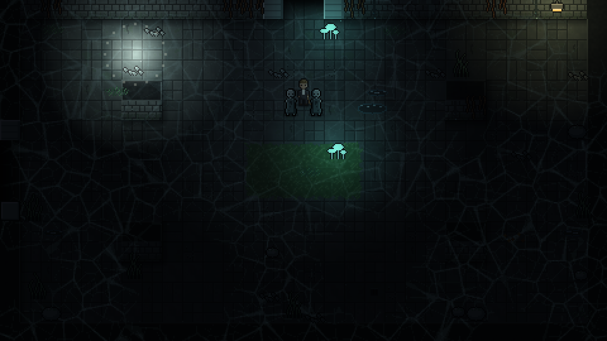

## Day 4: The finale, the pause menu, two more endings

Sunday was the day the game became playable from start to finish for the first time. Title screen, finale, pause
menu, settings with freely assignable keys, saving at the start of every section.

The final boss is called The One Who Stays. I won't say much about him, only this much: he isn't a classic boss fight,
and hitting harder doesn't get you anywhere.

Depending on how you deal with him, there isn't just one ending. Besides the actual ending there are two more. I
thought for a long time about whether they're too harsh. I believe they belong.

## Day 5: Ten minutes is not enough

On Monday I played the first complete run. Result: ten minutes. Too few rooms, and the traps were just standing around
in the open, you simply walked around them.

So more was added. More rooms per act (that's just a number in the generator), large rooms spanning two screens with a
camera that follows Jonas, new enemies (one that leaves puddles, a shadow that mirrors Jonas's movements, one that
pulls him in), quiet traps like currents, false floors and gas, and above all rooms built around
their traps. You have to go through, not around.

Then came trial rooms, where the doors close until all enemies are defeated. In the first version the stone slabs
slammed into the doors so fast that I genuinely flinched while testing. Now everything stands still first, then one
slab after another slides slowly and heavily into the doors from outside, with grinding, impact and dust. Before that
it was worse: the doors simply shut, and I didn't even notice I was in a trial.

After the second run the playtime was around 45 minutes. That feels right for this story.

## Pixel art, although I'm not an artist

I have to admit something at this point: I can't draw. Not even pixels.

That's why the characters are created via a Lua script for Aseprite's command line. In it, the sprites are written as
text, line by line, one character per pixel, with a shared palette. Claude writes these pixels, I look at them and say
what's wrong. That sounds cumbersome, and it is, but it works surprisingly well as long as you describe very precisely
what's wrong.

A few pieces of feedback I gave, and what came of them:

- Jonas and the other characters looked too flat. A shader that brightens the edges didn't help, because the suit is
  almost black in the dim light. Now all characters get shading with light from the top left.
- In the first version, the car wreck was a rectangle of uniform width and looked like a vending machine.
- The root plate of the fallen tree looked like a wagon wheel as a disc with spokes. Like a bush as a bright lump. Only
  the third version was a root plate.
- The stone hand in the third act initially had a hard-split, oval palm. It looked like a halved egg.
- The germ in the second act was round and seemed to float. Now it lies flat on the ground and has pseudopods.

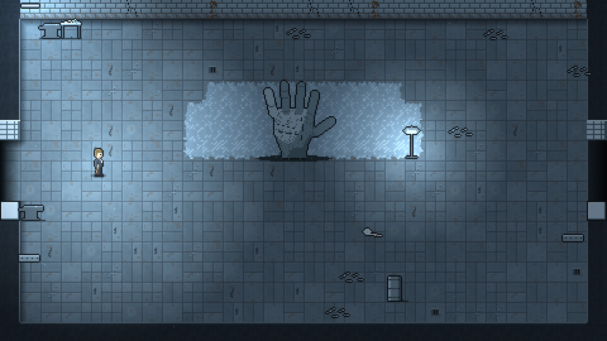

The tiles come from a script too. One of the things I learned: a joint on every tile edge looks like graph paper.

## A few things you don't see

A large part of the work goes into small details that nobody is supposed to notice:

- During scene changes a gray frame flashed between scenes. Solution: black background color, and during transitions
  to white it briefly turns white.
- In the word puzzles, pillars, enemies or Jonas himself sometimes covered one of the word stones, and the word seemed
  to be missing. Now nothing tall stands in front of any word stone, and the words are drawn on top of everything.
- In one room in the third act a word stone sat so far to the top left that its word disappeared under the health
  display. Since then a script checks all room templates: dimensions, doors, reachability with the abilities of the
  respective act, no enemy right next to a door (a clamp there immediately rammed Jonas back out) and, of course, no
  word stones under the display.
- A smoke test starts every scene of the game without a window, opens all menus and reports errors. In German and in
  English.

English, by the way, was only added on Tuesday. The spoken language is always German, but subtitles, menus and credits
are now available in both languages. Funniest hurdle: in the word puzzles, the English sentence has to have exactly as
many words as the room has stones. So some translations had to be rephrased until the word count matched exactly.

## The credits as a look back

The in-game images in this post are all photos from the credits. There, the song „Ab jetzt“ ("From Now On") plays,
and twenty images from the game pass by, from the embankment to the finale. Originally there were
eleven text panels of 17 seconds each on a black background, which was too long for me.

The photos are taken by a test script itself: it starts the game with a fixed seed, jumps into each act, places Jonas
in a suitable spot, makes him invulnerable, hides the UI and captures the image pixel-perfect. About three minutes,
and all twenty images are there. If a character changes, I simply retake the affected images. Once, The Smith was
missing completely. His spritesheet had grown, and Godot hadn't reimported it yet.

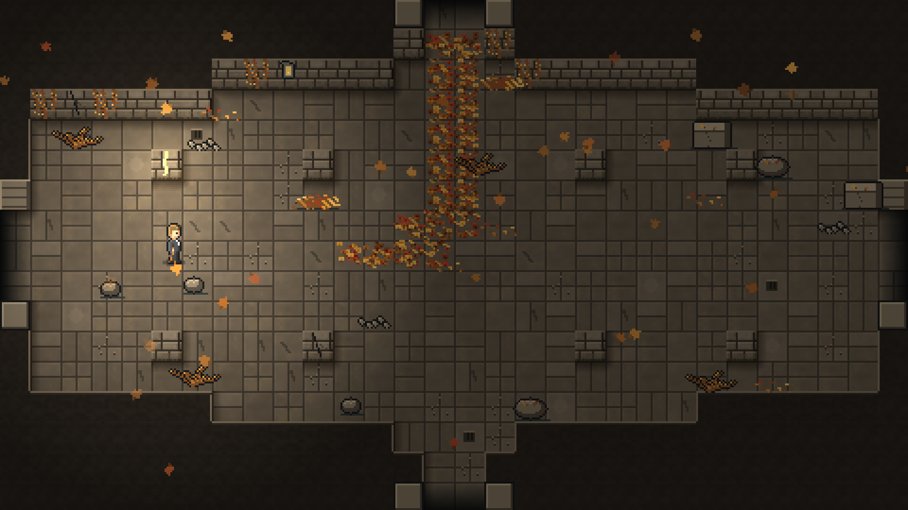

## Days 6 and 7: Shipping

The last two days were unspectacular and still exhausting. Exports for Windows, Linux and macOS as a universal app. A
GitHub Actions workflow that builds on every tag, creates a release and uploads the game to itch.io with butler and to
Game Jolt with gjpush. An icon made from the deer's head. Banners and cover images for the store pages.

macOS took the most time. Without a signature, from macOS 15 on you have to explicitly choose "Open Anyway" in System
Settings; right-click and Open is no longer enough. I have an Apple developer account, so the workflow now signs the
app with rcodesign and notarizes it itself. On a Linux runner, without a Mac. Honestly, I was surprised that works.

Finally, the debug mode was removed from the settings. It has test keys, jumps into every section and a display of
everything that's currently going on. Indispensable for me, not so much for players. In shipped builds it's now only
enabled when I trigger the build by hand.

## How much of this is AI?

A lot. I don't want to beat around the bush.

The voices are from ElevenLabs, the music from Suno, the painted images from FLUX and Qwen, and by far the largest
part of the code, the tool scripts and the pixels was written by Claude Code. That's also what it says in the credits.

What I did: co-developed the story and decided which voice, which track and which image gets used. Played, played,
played. Said what felt wrong. That the stone slabs were too fast. That Jonas looked flat. That ten minutes weren't
enough. That the wreck looked like a vending machine. I picked the music on Suno and recorded Mia's motif in
GarageBand.

Whether this is a "real" game is debatable. In any case, this week I got a game that tells exactly the story I wanted
to tell, and that I would never have managed to finish on my own at this scope. Not in a week, and not in a year.

What I learned: the tools are good at building things. Whether it feels right still needs someone to play it and say
so. In my project notes, a surprising number of improvements start with "Pete found …".

## Play it

„Wildwechsel“ is available for Windows, Linux and macOS:

- [itch.io](https://pmoscode.itch.io/wildwechsel)
- [Game Jolt](https://gamejolt.com/games/wildwechsel/1112928)

It's best played with headphones and in the dark.
